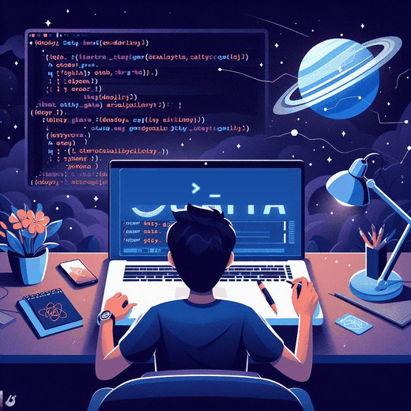
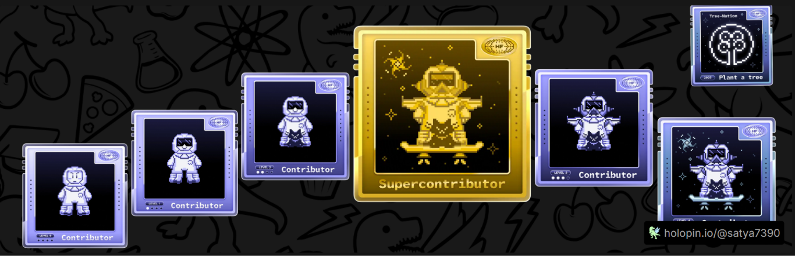
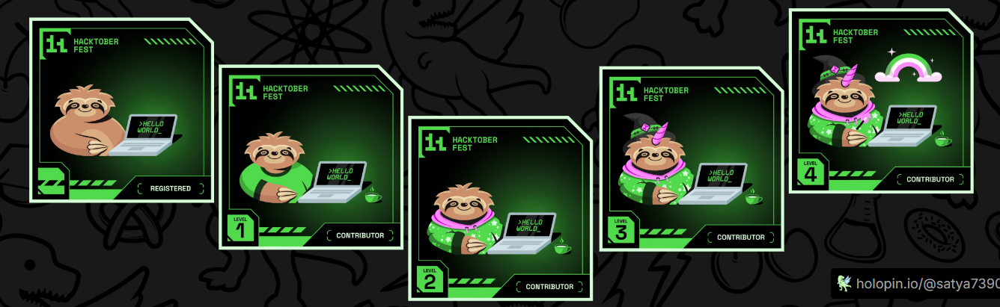
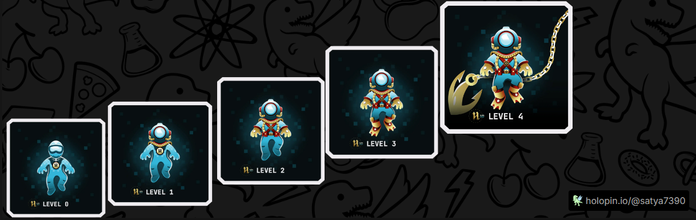

<!-- 

  <!-- Header Banner -->
  

  <!-- Animated Typing Welcome Message -->
  

  

    <strong>Java Full Stack Developer | Spring Boot & React | 3x Google Cloud Arcade Facilitator</strong>
  

  <!-- Quick Interactive Action Buttons -->
  

    
    &nbsp;
    
    &nbsp;
    
    &nbsp;
    
    &nbsp;
    
  

### 👨‍💻 About Me

<table>
  <tr>
    <td width="60%" valign="top">
      <ul>
        <li>💼 <strong>Current Role:</strong> Trainee Software Engineer at <strong>Sthapatya Software Pvt. Ltd.</strong> (Formerly Java Full Stack Trainee at <strong>HefShine Software</strong>).</li>
        <li>☕ <strong>Core Expertise:</strong> Enterprise backend engineering using <strong>Core Java</strong>, <strong>Spring Boot</strong>, <strong>RESTful APIs</strong>, and <strong>MVC Architecture</strong>.</li>
        <li>⚛️ <strong>Modern Frontend:</strong> Dynamic, responsive web applications built with <strong>React.js</strong>, <strong>Tailwind CSS</strong>, <strong>HTML5</strong>, and <strong>JavaScript</strong>.</li>
        <li>☁️ <strong>Cloud & DevOps:</strong> <strong>3x Google Cloud Arcade Facilitator</strong> and hands-on experience deploying scalable applications to <strong>AWS Cloud</strong>.</li>
        <li>🗄️ <strong>Databases:</strong> Proficient in <strong>MySQL</strong> schema design, relational modeling, and <strong>MongoDB</strong> NoSQL.</li>
        <li>🏆 <strong>Achievements:</strong> Open-source contributor in <strong>Hacktoberfest (2023, 2024, 2025)</strong>, Microsoft AI Odyssey Certified, and 12th Rank in IBSAT National Mock Test.</li>
        <li>🌐 <strong>Live Portfolio:</strong> <a href="https://satya-portfolio.vercel.app/" target="_blank">satya-portfolio.vercel.app</a></li>
      </ul>
    </td>
    <td width="40%" align="center" valign="middle">
      
    </td>
  </tr>
</table>

### 🔥 Toolbelt & Tech Stack

  
<strong>Languages</strong>

  

  
<strong>Frameworks & Libraries</strong>

  

  
<strong>Databases & Backend</strong>

  

  
<strong>Cloud, DevOps & Tools</strong>

  

### 🐍 GitHub Contribution Snake Animation

  
<em>Watch the cyber snake crawl through my real-time contribution grid:</em>

  <picture>
    <source media="(prefers-color-scheme: dark)" srcset="https://raw.githubusercontent.com/Satya7390/Satya7390/output/github-contribution-grid-snake-dark.svg">
    <source media="(prefers-color-scheme: light)" srcset="https://raw.githubusercontent.com/Satya7390/Satya7390/output/github-contribution-grid-snake.svg">
    
  </picture>

### 📊 GitHub Analytics & Activity

  

    
  

### 🌟 Hacktoberfest Achievements

  <h4>🚀 Hacktoberfest 2025</h4>
  

    
  

  <h4>🚀 Hacktoberfest 2024</h4>
  

    
  

  <h4>🚀 Hacktoberfest 2023</h4>
  

### 🌐 Connect With Me

  
  &nbsp;
  
  &nbsp;
  
  &nbsp;
  
  &nbsp;
  
    
  
  &nbsp;
  
  &nbsp;
  

  <blockquote>
    💡 <em>"Code with clarity, engineer for scalability, and build to create lasting impact."</em> 
    <strong>Let’s build something extraordinary together! 🚀</strong>
  </blockquote>

 -->
